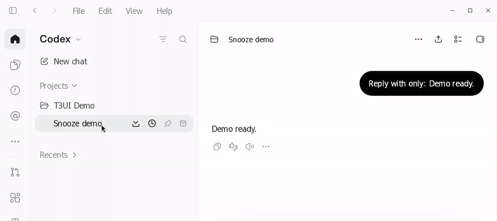

# T3UI 1.1.1

Settle finished Codex chats or snooze chats until a chosen time. T3UI replaces the Settle 1.0 tweak and reads its existing Settled chats and disclosure preference.

## Use

- Click the **Settle** tray icon on a finished chat to move it to **Settled** (**已收起**). Select its title to open it or choose **Un-settle** (**移回侧栏**) to restore it to its original position.
- Click the **Snooze** clock (**稍后处理**) on a chat and pick **In 1 hour**, **Tomorrow at 9 AM**, or a custom date and time. Expand **Snoozed** to see the wake time, reopen the chat, or choose **Wake now** (**立即恢复**).
- **Undo** is available immediately after settling or snoozing a chat.

Snoozing a running chat leaves its work running. Chats resurface at their wake time while Codex is open, or on its next launch if closed. A chat can also wake early if the sidebar shows a new approval, question, or error. Snooze uses this desktop's sidebar and clock.

## Windows Snooze demo

See a demo chat move from its project to **Snoozed** after choosing **In 1 hour**. The entry displays the scheduled wake time and the **Wake now** action.

[Download the MP4](../../docs/demos/t3ui-snooze-windows.mp4?raw=true)

## Install or disable

In **Codex Tweaks → Packages**, install the package folder or ZIP, build **T3UI** if prompted, and enable its switch. When upgrading from Settle 1.0, turn off **ct-settle** before enabling T3UI. Disabling T3UI restores the native sidebar. Your local preferences are available when you enable the tweak again.

## Compatibility and storage

- Codex Tweaks API v3. Built for macOS with Codex Tweaks 3.5.12 and ChatGPT Desktop 26.1111.71704.
- The demo was verified with T3UI 1.1.1, Codex Tweaks 3.5.12, and Windows ChatGPT Desktop 26.1117.4957.0 (x64) running under Wine 11.22 on Boat.
- The tweak uses durable thread IDs on Codex sidebar rows. Account and workspace identity must be available. A snooze can wake early when Codex has the matching row loaded and exposes its status.
- The renderer reads sidebar data and the app's initialized account and workspace identifiers. It stores chat titles, IDs, wake times, and disclosure preferences on this desktop under a hashed account/workspace ID. It can use Codex's thread-opening command for a chat outside the loaded sidebar. No Node permission, package dependencies, or external network access is required.
- If a chat has been removed in Codex, clear its entry with **Un-settle** or **Wake now**.

## Development

Build through **Codex Tweaks → Packages → Build/Rebuild**.
